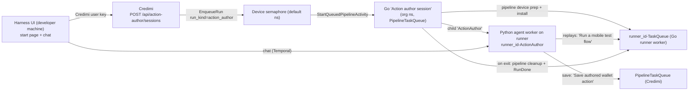

<!--
SPDX-FileCopyrightText: 2026 Forkbomb BV

SPDX-License-Identifier: AGPL-3.0-or-later
-->

# Action author on Credimi runners

## Context

The action author agent (Python, Temporal Agent Harness) currently drives a device attached to the machine that runs its worker, with model settings in a local `.env`: an adb phone (`ACTION_AUTHOR_DEVICE_SERIAL`) or, on a Mac, clones of a local iOS simulator (`ACTION_AUTHOR_IOS_SIMULATOR_UDID`, `agents/action-author/src/credimi_action_author/ios.py`, see `.agents/HITL.md` "Action author on iOS simulators"). Move it onto Credimi runners, exactly the way pipelines use devices:
- the device is reserved through the mobile-device semaphore;
- it is prepared and installed with the pipeline's own code, and cleaned with the pipeline's own cleanup on every exit.

Both platforms move: Android devices (`android_phone`, `android_emulator`, `redroid`) on Linux or macOS runners, and `ios_simulator` devices on native macOS runners. `ios_phone` is not supported: a reset needs a simulator clone. The platform is never chosen by the user: it follows the selected device's type (`android*`/`redroid` → `android`, `ios_simulator` → `ios`), and selects the wallet version's installer (`android_installer` or `ios_installer`, a zipped simulator `.app`).

The Python agent and its device tools (agent-device, Maestro MCP) run on the runner host, next to the device. Model settings (provider, URL, API key, model) are configured in the runner's `config.toml` and dashboard. Only admin-managed runners support the feature, and only owners of the runner's organization can start sessions on them. The chat UI stays a developer-run harness UI. Duplicate and obsolete code is deleted:
- the Python local-device mode (adb phone and local iOS simulator);
- the installer download grant;
- the ChatGPT-subscription provider;
- the Python download, install and replay code (Android and iOS);
- `agents/action-author` in credimi.

What the local iOS mode proved, and the runner design keeps (spike and smoke on a Mac, 29/10/2026, Xcode 27.1, iOS 26.5, agent-device 0.21.32, Maestro 2.11/2.12):
- agent-device and Maestro can drive one simulator at once; the Maestro turn-taking (close the agent-device session first) is required only on Android but is kept for one code path;
- `simctl` has no `pm clear` and an uninstall keeps keychain items, so an iOS reset is a fresh `simctl clone` of a shut-down simulator holding the freshly installed app (about 15 s, plus about 20 s for the first Maestro command on each clone);
- a freshly booted clone can answer `bootstatus` before it lists the app: poll `simctl get_app_container` before using it;
- Maestro `back` is a no-op on iOS (the agent instructions say so); Maestro MCP `inspect_screen` needs Maestro 2.11+ and returns accessibility identifiers as `rid`.

Repos and branches:
- **credimi** `/home/filippo/forkbomb/credimi-2`, branch `feat/action-author-poc` (PR #1550).
- **credimi-runner** `/home/filippo/forkbomb/credimi-runner`, new branch `feat/action-author-agent` from `main`. Read its `AGENTS.md`, `PURIA.md` and `DESIGN.md` first: Taskfile, `mise.toml`, Conventional Commits with `reason:`/`prompt:`, tests for all code, and Go coverage above 85%.
- **credimi-extra** needs **no change**: the runner already registers every device activity this design uses, for both platforms (`StartIOSSimulator` clones the runner's base simulator per run, `InstallIOSApp`, `IOSPostInstallChecks`, `CleanupDevice` deletes that clone by UDID).

Target architecture:



## Approach
Credimi Go steps (1–6) come before the runner steps (7–12). Step 13 removes the old Python code from credimi. Each step leaves its repo building and its tests passing.

### 1. credimi: base on the merged semaphore fixes
- PR #1553 (queue wait timeout, graceful cancel of running tickets, early device tracking in `mobile_automation_hooks.go`) must already be on `main`.
- Run `git fetch origin && git merge origin/main` on `feat/action-author-poc`, resolve conflicts, and run `make test`.
- Steps 2–4 build on the post-#1553 `processStep` and `EnqueueRun` fields.

### 2. credimi: expose device preparation from the pipeline package
In `pkg/workflowengine/pipeline/mobile_automation_hooks.go`, extract from `processStep` the part that prepares one device, and make it exported:

```go
// MobileDeviceRequest names one device to prepare for a run.
type MobileDeviceRequest struct {
	DeviceID          string // canonified device path
	VersionIdentifier string // wallet version identifier to install
	StepID            string // label used in errors and run identifiers
	RunIdentifier     string
}

// PreparedMobileDevice is what a run needs to drive the prepared device.
type PreparedMobileDevice struct {
	RunnerID      string `json:"runner_id"`
	Serial        string `json:"serial"` // adb serial, or the UDID of the run's simulator clone
	Type          string `json:"type"`
	PackageID     string `json:"package_id"` // Android package or iOS bundle ID
	InstallerPath string `json:"installer_path"` // runner-host path of the installed APK or .app
}

func PrepareMobileDevice(
	ctx workflow.Context,
	ao workflow.ActivityOptions,
	settedDevices map[string]any,
	req MobileDeviceRequest,
) (PreparedMobileDevice, error)
```

- **Body:** move the existing sequence from `processStep` into it, unchanged:
  1. `getOrCreateDeviceMap` (with the #1553 early tracking);
  2. host runner check, then `mobileRunnerActivityOptions`;
  3. `ensureInitialInstalledAppsTracked`;
  4. `preparePhysicalAndroidDeviceIfNeeded`;
  5. `fetchAndInstallAPK`, with `payload := &workflows.MobileAutomationWorkflowPipelinePayload{DeviceID: req.DeviceID, VersionID: req.VersionIdentifier}`, `step := &pipeline.StepSpec{ID: req.StepID}`, and `skipInstaller` as today.

  `PackageID` is `deviceMap["installed"].(map[string]string)[req.VersionIdentifier]`. If it is empty, return `UnexpectedActivityOutput` with message `missing installed package for <version>`.

  `InstallerPath` is the `installer_path` the runner's `installer-action` returned (`parseInstallerResponse`, today only the local `apkPath` in `fetchAndInstallAPK`; for iOS the runner has already unzipped it to the `.app`). Make `fetchAndInstallAPK` return it; it is not stored in run data. When the installer is skipped (`installed_from_external_source`, or the version already installed in this run) it is empty, and `PrepareMobileDevice` fails for `ios_simulator` with `UnexpectedActivityOutput` `missing installer path for <version>`: the iOS reset reinstalls from it (step 8).
- **iOS is already handled by the extracted sequence:** for `ios_simulator`, `setupNewDevice` runs `Setup iOS simulator` (a fresh clone of the runner's base simulator, `IOS_UDID`), whose UDID becomes `Serial`; `InstallIOSApp` installs the `.app`, and `IOSPostInstallChecks` returns the bundle ID and **launches the app once** (`runMaestroLaunch`), so after preparation the app data is not pristine. Step 8 resets it.
- **`processStep`:** it keeps decoding and validating the step payload, then calls `PrepareMobileDevice`. With the returned values it sets the same step config (`taskqueue`, `runner_id`, step id, `run_identifier`) and payload fields (`serial`, `type`) as today, followed by the existing `SetRunDataValue` calls. Pipeline behavior must not change; this is a pure refactor, with no new GetVersion.
- **Semaphore report:** export `reportMobileDeviceSemaphoreDone` (`pkg/workflowengine/pipeline/semaphore_done.go:18`) as `ReportMobileDeviceSemaphoreDone`, same signature. Update every caller (`grep -rn "reportMobileDeviceSemaphoreDone" pkg`).
- `MobileAutomationCleanupHook` is already exported; reuse it as is.

### 3. credimi: "Action author session" Go workflow
Create `pkg/workflowengine/authorsession/session.go`. No existing workflow pairs pipeline device handling with a harness child.

- **Name:** `const WorkflowName = "Action author session"`. The struct implements `workflowengine.Workflow` like other workflows: `Name()` and `Workflow(ctx, workflowengine.WorkflowInput)`.
- **Input payload:**

  ```go
  type SessionInput struct {
  	DeviceID                string `json:"device_id"`
  	Platform                string `json:"platform"` // "android" | "ios", derived from the device type in step 5
  	WalletVersionIdentifier string `json:"wallet_version_identifier"`
  	ActorID                 string `json:"actor_id"`
  	ActorCollection         string `json:"actor_collection"`
  	Slot                    string `json:"slot"`
  	AppID                   string `json:"app_id,omitempty"`
  }
  ```

  The input config carries the four `mobile_device_semaphore_*` keys, which `StartQueuedPipelineActivity` injects.
- **Sequence:**
  1. Build `runData := map[string]any{"run_identifier": <own workflow ID>, "setted_devices": settedDevices}`, where `settedDevices := map[string]any{}`. Register **first** a `defer` that runs in a `workflow.NewDisconnectedContext`:
     - `pipeline.MobileAutomationCleanupHook(dctx, nil, &cleanupAO, input.Config, runData, &output)`; log any returned error and don't fail on it;
     - then `pipeline.ReportMobileDeviceSemaphoreDone(dctx, logger, input.Config, id, runID, result)`, where `result` is `"completed"` or `"failed"` (the values pipelines pass — confirm in `pipeline.go`).

     `cleanupAO` is `{StartToCloseTimeout: 10m, ScheduleToCloseTimeout: 20m, HeartbeatTimeout: 30s, RetryPolicy{MaximumAttempts: 3}}`.
  2. Resolve the build: execute activity `"Resolve action author build"`, using the existing name constant from `pkg/workflowengine/activities/action_author.go`. Its task queue is `PipelineTaskQueue` and its payload is `actionauthor.BuildRequest{WalletVersionIdentifier, Platform, Actor…}`, the same type the activity already decodes (`Platform` selects `android_installer` or `ios_installer`; a version without that installer fails with `ErrInvalid`). Decode `actionauthor.Build` from `Output`; it carries `platform` and `installer_sha256`.
  3. `prepared, err := pipeline.PrepareMobileDevice(ctx, ao, settedDevices, MobileDeviceRequest{DeviceID, VersionIdentifier: build.VersionIdentifier, StepID: "action-author", RunIdentifier})`. Here `ao` is the pipeline default (`pipeline.PrepareWorkflowOptions(nil).ActivityOptions`, or the default used by `StartQueuedPipelineActivity` — confirm the helper name).
  4. If `AppID != ""` and `AppID != prepared.PackageID`, fail with `MissingOrInvalidPayload`: `selected build is <pkg>, not <app_id>`.
  5. Execute the child workflow `"ActionAuthor"`:
     - ID: `<own workflow ID>-author`
     - task queue: `<prepared.RunnerID>-ActionAuthor`
     - `WorkflowExecutionTimeout: 2h`
     - `ParentClosePolicy: TERMINATE`
     - args: `map[string]any{}` then `AuthoringContext`

     Wait for the result. Any child outcome (completed, canceled, timed out, terminated, failed) ends the session normally. The defer then cleans the device and releases the semaphore.

- **`AuthoringContext`** (Go struct, JSON exactly as below; the Python model in step 8 must match):

  ```json
  {"wallet_version_identifier": "...", "actor_id": "...", "actor_collection": "users", "slot": "onboarding", "app_id": "", "platform": "ios",
   "build":  {"wallet_id": "...", "version_id": "...", "version_identifier": "...", "owner_namespace": "...", "platform": "ios", "installer_sha256": "..."},
   "device": {"device_id": "...", "runner_id": "...", "serial": "<clone UDID or adb serial>", "type": "ios_simulator", "package_id": "...", "installer_path": "..."}}
  ```

  `platform` is `SessionInput.Platform`; `build_payload()` (Python) keeps returning the `BuildRequest` fields, platform included, for the save activity.

- No video recording and no device-log capture are started. `cleanupDeviceCaptures` then returns early (its flags are absent), so nothing is uploaded to pipeline results.
- **Registration:** register the workflow on the `PipelineTaskQueue` worker in `pkg/workflowengine/hooks/hook.go`, next to the other `RegisterWorkflowWithOptions` calls.

### 4. credimi: semaphore ticket kind for sessions
- **`mobiledevicesemaphore/types.go`:** add these fields to `MobileDeviceSemaphoreEnqueueRunRequest`. Also add them to `activities.StartQueuedPipelineActivityInput` (`pkg/workflowengine/activities/queued_pipeline.go:37`):

  ```go
  RunKind      string         `json:"run_kind,omitempty"`      // "" = pipeline, "action_author"
  ActionAuthor map[string]any `json:"action_author,omitempty"` // authorsession.SessionInput as a map
  ```

  Declare `const RunKindActionAuthor = "action_author"` in `mobiledevicesemaphore`.
- **Semaphore:** copy both fields into `StartQueuedPipelineActivityInput` where it is built (`mobile_device_semaphore.go`, around line 1093). Copying a field emits no new command, so no GetVersion is needed. The enqueue validator needs no change; it doesn't require YAML.
- **`StartQueuedPipelineActivity`:** when `RunKind == RunKindActionAuthor`, start workflow `"Action author session"` instead of the pipeline, in `OwnerNamespace` on `PipelineTaskQueue`:
  - ID: `ActionAuthorSession-<ticket>`
  - conflict and reuse policies: the same `REJECT_DUPLICATE`/`USE_EXISTING` pair used for pipelines, including the describe-after-close path
  - `WorkflowExecutionTimeout: 3h`
  - payload: `ActionAuthor`
  - config: the injected `mobile_device_semaphore_*` keys (not `global_device_id`/`no_video`)

  Skip `pipeline_results` creation and return `WorkflowID`/`RunID`/`WorkflowNamespace`. The pipeline path is unchanged.
- `GET`/`DELETE /api/pipeline/queue/{ticket}`, the safety net and `RunDone` already work by ticket and workflow ID, so they serve sessions unchanged.

### 5. credimi: session start and device list endpoints
In `pkg/internal/apis/handlers/action_author.go`:

- **`POST /api/action-author/sessions`**, body:

  ```go
  type ActionAuthorStartRequest struct {
  	DeviceID                string `json:"device_id" validate:"required"`
  	WalletVersionIdentifier string `json:"wallet_version_identifier" validate:"required"`
  	Slot                    string `json:"slot" validate:"required,oneof=onboarding"`
  	AppID                   string `json:"app_id,omitempty"`
  }
  ```

  Keep the existing validation style and the existing `Slot`/`AppID` rules. The local-mode `platform` field is removed (clean cutover): the device decides the platform.

  Checks, in order (errors via `authoringAPIError`/`apierror.New`, domain `action_author`):
  1. Run `mobilerunner.ResolveDevice` for `DeviceID`, then load its runner record. If the device isn't found, return `404` reason `device_not_found`.
  2. Map the device `type` to the platform: `android_phone`, `android_emulator`, `redroid` → `android`; `ios_simulator` → `ios`. Any other type (`ios_phone`) returns `422` reason `device_type_not_supported`, message `the action author supports Android devices and iOS simulators`.
  3. Run `actionauthor.Select(e.App, "", request)` with that `Platform`, as today: the caller must be an owner of the wallet's organization, or a superuser, and the version must have the platform's installer (`400` `selected version has no iOS app` otherwise).
  4. If `runner.admin_managed` is false, return `403` reason `runner_not_supported`, message `the action author runs only on admin-managed runners`.
  5. If `runner.owner` isn't `selection.Organization.Id`, return `403` reason `runner_not_owned`, message `the device's runner belongs to another organization`.
  6. Run `requireMobileDeviceRunnersOnline(e, []string{deviceID})` (`mobile_runner_availability.go`); it keeps its `503`.
  7. Enqueue with `semaphoreclient.EnqueueRun` (`pkg/workflowengine/semaphoreclient`):
     - ticket: a new UUID
     - `OwnerNamespace`: the org's `canonified_name`
     - `EnqueuedAt: time.Now().UTC()`
     - `DeviceID`, `RequiredDeviceIDs: []string{deviceID}`, `LeaderDeviceID: deviceID`
     - `MaxPipelinesInQueue`: the org's `max_pipelines_in_queue`
     - `WaitTimeoutSeconds: semaphoreclient.WaitTimeoutSeconds()` (from #1553)
     - `RunKind: RunKindActionAuthor`
     - `ActionAuthor`: `SessionInput` (with `Platform`) encoded as a map

     Use the same Temporal client helper the queue handler uses. If no client can be obtained, return `temporalUnavailableError()`. Map queue-limit errors the way `enqueuePipelineRun` does (`isQueueLimitExceeded`, `429`).
  8. Respond `202` with:

     ```go
     type ActionAuthorStartResponse struct {
     	TicketID                string `json:"ticket_id"`
     	DeviceID                string `json:"device_id"`
     	Status                  string `json:"status"`
     	Position                int    `json:"position"`
     	WorkflowNamespace       string `json:"workflow_namespace"`
     	WalletVersionIdentifier string `json:"wallet_version_identifier"`
     }
     ```

     The client polls `GET /api/pipeline/queue/{ticket}?device_ids=<device>`. Once it is `running`, its `workflow_id` is the session ID, and the chat workflow is `<workflow_id>-author`.

- **New route `GET /api/action-author/devices`** (same authenticated group), response `{devices: [{path, name, runner_name, type, platform, is_online}]}`:
  - devices of runners that are `admin_managed`, not `disabled`, and owned by an organization where the caller holds the `owner` role (superusers: all admin-managed runners);
  - `is_online` uses the same computation as `GET /api/mobile-devices`: reuse the helpers in `mobile_runners_handlers.go:268-379` (confirm their names before calling).
  - `platform` is the step-2 mapping; devices of unsupported types (`ios_phone`) are not listed.
  - Sort by `runner_name`, then `name`.
- Remove the old direct `ExecuteWorkflow` start, the `actionAuthorTaskQueue` constant and the request `platform` field.
- Regenerate the OpenAPI doc: `go generate ./pkg/gen.go`.

### 6. credimi: delete the installer grant flow
- **Delete:**
  - `pkg/internal/actionauthor/installer.go` (`installerGrant`, `grantKey`, `issueGrant`, `Installer`, `OpenInstaller`, …);
  - the `GET /api/action-author/installer` route, handler and tests;
  - `Build.DownloadGrant` and `Build.InstallerName`, plus their assignments in `Resolve`;
  - `RouteDefinition.ResponseContentType` (`pkg/internal/routing/routing.go:45`) and its use in `pkg/generate_client/generate_client.go` (`RouteInfo.ResponseContentType`, the content-type default in `addOperationResponses`). The installer route is its only user: confirm with `grep -rn ResponseContentType pkg`.
- **Keep:** `ResponseStatus`, used by the `202`.
- `Resolve` keeps returning `Platform` and `InstallerSHA256` from `installerDigest`, for provenance; `Save` keeps comparing them.

### 7. runner: move the Python agent into credimi-runner
Copy `credimi-2/agents/action-author/{src,tests,pyproject.toml,uv.lock,README.md,CHANGELOG.md,.env.example,.gitignore}` to `credimi-runner/agent/`. Keep the package name `credimi_action_author`. Do **not** copy `agents.toml`, `action-author.schema.json`, `out/` or `.venv/`. Then make these deletions and changes before step 8:

- **Delete the ChatGPT provider:** `chatgpt_auth.py`, `chatgpt_model.py`, `tests/test_chatgpt_auth.py`, `tests/test_chatgpt_model.py`, and every `ACTION_AUTHOR_CHATGPT*` reference.
- **Delete local download, install and replay:** `installer.py`, `apk.py`, `tests/test_apk.py`, and the `prepare_build` and `replay_action` activities and their Python models in `activities.py`/`models.py` (`PrepareBuildRequest`, `InstalledBuild`, `ReplayRequest`, …).
  - Also delete from `device.py` `AndroidDevice.maestro_test`, `prepare_build`, `verify_build`, and the `apkanalyzer` requirement.
  - From `ios.py` delete `app_root`, `extract_app`, `read_app_info`, `IOSSimulatorDevice.prepare_build`, `verify_build`, `check_base` and the base-simulator template (`ACTION_AUTHOR_IOS_SIMULATOR_UDID`): the runner prepares the device. Keep the clone helpers (`_clone_booted`, `_delete`, `_wait_for_app`, stale-clone removal) for step 8.
  - Delete `ResolvedBuild.download_grant`/`installer_name` and the Python call to `Resolve action author build` (Go resolves now).
  - Delete the out-dir writing (`ACTION_AUTHOR_OUT_DIR`, `accepted_path`). The accepted YAML lives only in workflow state and the reply.
- **Delete compatibility for old local histories.** No local-mode history will replay on the new worker: it uses a different task queue and namespace binding.
  - Remove every `workflow.patched(...)` call in `workflow.py` and `tools.py`, keeping the **new** branch of each.
  - Remove the legacy `save_wallet_action` `@agent.accepts` handler, keeping `_persist_candidate` for the callback path, and the `SaveActionApproval.replace_action_id`/`expected_existing_sha256` fields with the replacement check (the callback path never replaces).
  - Remove the `save_wallet_action` filter in `ui.py` that existed only for that handler.
- **Provider selection (`worker.py`)** becomes one explicit setting; drop the old precedence logic:
  - `ACTION_AUTHOR_PROVIDER` = `anthropic` | `openai_compatible` | `fake`. Any other value makes the worker exit with code 2: `ACTION_AUTHOR_PROVIDER must be anthropic, openai_compatible or fake`.
  - `anthropic`: `ACTION_AUTHOR_MODEL_API_KEY`, `ACTION_AUTHOR_MODEL` (default `claude-sonnet-5-5`), `ACTION_AUTHOR_ANTHROPIC_CACHE_TTL` (`5m` default, `1h`, `off`), `ACTION_AUTHOR_ANTHROPIC_CONTEXT_TOKENS` (default `30000`). Uses `AnthropicModelProvider`.
  - `openai_compatible`: `ACTION_AUTHOR_MODEL_BASE_URL` (required), `ACTION_AUTHOR_MODEL_API_KEY`, `ACTION_AUTHOR_MODEL` (required). Uses the existing Chat Completions path. OpenAI itself is `https://api.openai.com/v1`.
  - `fake`: `ScriptedModelProvider`, for tests and dry runs.
  - Delete `ACTION_AUTHOR_ANTHROPIC`, `ACTION_AUTHOR_FAKE_MODEL`, `OPENAI_API_KEY` handling and their tests.
  - Update `tests/test_compatible_endpoint.py` and `test_anthropic_model.py` to the new variables.
- **Worker binding:**
  - The worker polls `ACTION_AUTHOR_TASK_QUEUE` (required, e.g. `<runner_id>-ActionAuthor`) in `TEMPORAL_NAMESPACE` (required) at `TEMPORAL_ADDRESS`.
  - Delete `models.TASK_QUEUE`, the `action-author` default and the `default`-namespace refusal.
  - The device no longer comes from `ACTION_AUTHOR_DEVICE_SERIAL` or `ACTION_AUTHOR_IOS_SIMULATOR_UDID`: it arrives per session in `AuthoringContext.device` (step 8). One worker serves both platforms: the platform is per session (`AuthoringContext.platform`), so the local platform-mismatch check (`DeviceInfo.platform`) is deleted.

### 8. runner: the Python workflow drives the runner device
- **`contracts.py`:** replace `AuthoringContext` with the JSON shape from step 3. It has `platform`, nested `Build` (wallet_id, version_id, version_identifier, owner_namespace, platform, installer_sha256) and `Device` (device_id, runner_id, serial, type, package_id, installer_path); `extra="forbid"` stays.
  - `build_payload()` keeps returning the `BuildRequest` fields (platform included) for the Go save activity.
  - `session.bound_app_id` is `device.package_id`, `session.installer_sha256` is `build.installer_sha256`, `session.platform` is `platform`.
  - Add `RUN_MOBILE_FLOW = "Run a mobile test flow"` and `RUNNER_TASK_QUEUE_SUFFIX = "-TaskQueue"`.
- **Session load (`workflow._load_session`):** `session_limits` replaces `device_info` and returns `{token_budget, max_model_calls}` from the worker environment, with the existing defaults. On Android no other activity is called. On iOS it then runs `ios_prepare_template` (below) once, and the first `reset_app` boots the first clone.
- **The current device is workflow state.** `session.device_serial` starts as `device.serial` (Android: for the whole session). On iOS it is the UDID returned by the latest `reset_app`, empty before the first one. Activities never keep device state: they receive what they act on, so a restarted worker continues the session.
- **agent-device MCP:** `agent_device_factory(command)` no longer takes a device. The factory argument carries `{"platform", "serial", "app_id"}` and builds `AgentDeviceServer(command, arg["platform"], lambda: arg["serial"], arg.get("app_id", ""))` (it sends `serial` on Android and `udid` on iOS, as today). `session.device_context` holds the three keys and is updated in place after every iOS reset. If the serial is empty, the server returns `the device is not ready; call reset_app` (today's message).
- **Python device activities** (on the Python worker): `maestro_cheat_sheet`; `maestro_inspect_screen` and `close_session` take `{platform, serial}` (`maestro mcp inspect_screen` against that serial; `agent-device close --serial` or `--udid --platform ios`); `reset_app` takes `{platform, serial, app_id, template, clone_prefix}`:
  - Android: `agent-device close`, then `adb -s <serial> shell pm clear <app>`; returns the same serial.
  - iOS: `agent-device close` on the current clone, delete it (`simctl shutdown` + `delete`), `simctl clone <template> <clone_prefix>-<n>`, boot, `bootstatus -b`, then poll `simctl get_app_container` (30 × 1 s) for the app; returns the new UDID. This is today's `IOSSimulatorDevice._new_clone`, with the template and current clone passed in instead of held by the device object.
- **iOS template (`ios_prepare_template`, once per session).** The prepared device is the run's own clone `S` (`device.serial`), which the pipeline cleanup deletes at the end. The pipeline's post-install check launched the app once, so the activity restores a fresh install in `S` and turns it into the template: `simctl terminate S <app>` (ignore "not running"), `simctl uninstall S <app>`, `simctl install S <device.installer_path>`, `simctl keychain S reset`, `simctl get_app_container S <app>`, `simctl shutdown S`. The workflow stores `template = S`; clones are named `credimi-action-author-<S>-<n>`. `simctl clone` copies `S`'s data, so deleting `S` later does not affect a clone, and avdctl's cleanup deletes only `S` by UDID.
- **iOS clone cleanup.** Pipeline cleanup deletes only `S`, never the agent's clones:
  - the workflow's `@agent.teardown` runs `release_device` (`{platform, serial}`: on iOS delete the current clone; on Android nothing);
  - when the worker starts, it deletes every simulator named `credimi-action-author-<UDID>-*` whose `<UDID>` no longer exists (its session ended). A live session whose clone is lost to a crash gets `the device is not ready` and calls `reset_app`, which clones `S` again.
- **Verify the build before each replay:** Android keeps `installed_digest` against `build.installer_sha256` (now through `adb` on the runner host); iOS checks that the new clone lists `device.package_id` (the reset's own poll). The pipeline installed exactly the resolved installer, so no download happens on the worker.
- **Replays (`tools.submit_action`):** a failed static check or replay still uses the existing attempt budget. Run `REPLAY_RUNS` (2) times, sequentially:
  1. Execute the activity `reset_app` (local).
  2. Execute the Go activity `RUN_MOBILE_FLOW`:
     - task queue `device.runner_id + "-TaskQueue"`
     - input `{"payload": {"device_id", "yaml", "serial": <session.device_serial>, "type", "workflow_id": <session workflow id>, "step_id": "replay-<n>"}, "config": {}}`. On iOS `serial` is the clone UDID: `RunMobileFlow` waits for `bootstatus` and runs `maestro --device <udid> test` without the Android-only driver flags.
     - `start_to_close_timeout=15m`, `heartbeat_timeout=30s`, `schedule_to_start_timeout=30s`, `RetryPolicy(maximum_attempts=1)`
  3. On `ActivityError`, read `stdout` from the cause's `details[0]` (Maestro failure details), parse the failed command and tail with the existing `maestro.py` helpers, and run `maestro_inspect_screen` for the screen. Build `RunOutcome(passed=False, …)` and stop.
  4. On success, `RunOutcome(passed=True, completed=<parsed from output["output"]>)`.

  Accept only when both runs pass. This is the exact Maestro invocation pipelines use (`--no-reinstall-driver`, driver stop, per-device workspace on Android).
- **Idle and maximum duration:**
  - Add a workflow-local task started in `@agent.init`. It loops `await workflow.wait_condition(lambda: self._activity_seq != seen, timeout=timedelta(minutes=20))`. On timeout it calls the harness close handler the way the save path does (`workflow.get_signal_handler("close")`).
  - `self._activity_seq` increments when `ask` starts and ends, and when the save-review callback resolves.
  - A pending Accept/Refuse review left for 20 minutes therefore closes the session, and the review ends as "confirmation was canceled".
  - The 2-hour maximum is the child `WorkflowExecutionTimeout` set in step 3.
  - `IDLE_TIMEOUT = timedelta(minutes=20)` goes in `models.py`.
- **Instructions:** remove instruction text that mentions a local phone, `ACTION_AUTHOR_DEVICE_SERIAL`, `ACTION_AUTHOR_IOS_SIMULATOR_UDID` or `out/`. Keep `PLATFORM_NOTES` (iOS: fresh clone per reset, no Maestro `back`, system alerts) and the per-platform device line.

### 9. runner: agent settings in config and dashboard
Follow the existing settings recipe. The files come in the order below; read `DESIGN.md` before the template.

1. **`internal/config/model.go`:** add `Agent AgentConfig \`toml:"agent"\`` to `Config`:

   ```go
   type AgentConfig struct {
   	Enabled               bool   `toml:"enabled"`
   	Provider              string `toml:"provider"`               // anthropic | openai_compatible
   	ModelBaseURL          string `toml:"model_base_url"`
   	ModelAPIKey           string `toml:"model_api_key"`
   	Model                 string `toml:"model"`
   	AnthropicCacheTTL     string `toml:"anthropic_cache_ttl"`     // 5m | 1h | off
   	AnthropicContextTokens int   `toml:"anthropic_context_tokens"`
   	TokenBudget           int    `toml:"token_budget"`
   	MaxModelCalls         int    `toml:"max_model_calls"`
   }
   ```

   Defaults, applied where the other defaults are: `Provider "anthropic"`, `AnthropicCacheTTL "5m"`, `AnthropicContextTokens 30000`, `TokenBudget 600000`, `MaxModelCalls 80`.
2. **`internal/config/store.go` `Redacted()`:** mask `ModelAPIKey`.
3. **`internal/config/validate.go`:** when `Agent.Enabled`, enforce the following. The error strings are exact.
   - `Credimi.AuthMode == "internal_admin"`, else `action author requires an admin-managed runner (credimi.auth_mode = internal_admin)`.
   - `Runner.Organization != ""`, else `action author requires runner.organization`.
   - `Provider` is `anthropic` or `openai_compatible`, else `agent.provider must be anthropic or openai_compatible`.
   - `ModelAPIKey != ""`, else `agent.model_api_key is required`.
   - For `openai_compatible`: `ModelBaseURL` parses as `http`/`https` (`agent.model_base_url must be an http(s) URL`) and `Model != ""` (`agent.model is required`).
   - `AnthropicCacheTTL` is one of `5m`, `1h`, `off`.
   - `TokenBudget` and `MaxModelCalls` are greater than 0.
4. **`internal/dashboard/runtime/config.go`:** map both ways (`ValuesFromTypedConfig`, `TypedConfigFromValues`) with flat keys `ACTION_AUTHOR_ENABLED`, `ACTION_AUTHOR_PROVIDER`, `ACTION_AUTHOR_MODEL_BASE_URL`, `ACTION_AUTHOR_MODEL_API_KEY`, `ACTION_AUTHOR_MODEL`, `ACTION_AUTHOR_ANTHROPIC_CACHE_TTL`, `ACTION_AUTHOR_ANTHROPIC_CONTEXT_TOKENS`, `ACTION_AUTHOR_TOKEN_BUDGET`, `ACTION_AUTHOR_MAX_MODEL_CALLS`.
5. **`inventory.go` `RunnerKeys`:** add all nine.
6. **`runtime_plan.go` `FieldImpacts`:** all nine are `Runtime: true`, and `ACTION_AUTHOR_MODEL_API_KEY` is also `Secret: true`.
7. **`internal/dashboard/config.go` `Registry`:** a `Field` per key, in a new group `Action author`, with the API key marked `Secret: true`.
8. **`internal/dashboard/templates/config.html`:** a new `<section class="card">` titled `Action author`. It lists the fields with `{{template "field" .Field "KEY"}}`, plus a one-line note: `Available only on admin-managed runners. The API key is stored in config.toml.`
9. **`config.example.toml`:** an `[agent]` example with `enabled = false`.

Add tests in the existing files: `config_test.go` (Registry coverage), `secret_masking_test.go`, `toml_adapter_test.go`, `runtime/config_test.go` round trip, and the validation cases above.

### 10. runner: supervise the Python agent worker
- **New package `internal/agentworker`** (no existing generic child-process supervisor; `internal/edge/cloudflared.go` is the pattern to copy):

  ```go
  type Worker struct { /* cfg, cmd factory, logger */ }
  func New(cfg config.Config) *Worker
  func (w *Worker) Start(ctx context.Context) error // no-op when !cfg.Agent.Enabled
  func (w *Worker) Stop()
  func (w *Worker) Wait(ctx context.Context) error
  func (w *Worker) Running() bool
  ```

- **`Start`:** launches a goroutine that runs `uv run --frozen --project <dir> python -m credimi_action_author.worker`:
  - `<dir>` is `CREDIMI_ACTION_AUTHOR_DIR`, default the directory step 11 installs: `/opt/credimi/agent` in the image, `<state_dir>/tools/agent/<version>` natively.
  - The environment is an **allowlist**: `PATH`, `HOME`, `LANG`, `JAVA_HOME`, `ANDROID_HOME`, `ANDROID_SDK_ROOT`, `DEVELOPER_DIR` (macOS, when set), `TEMPORAL_ADDRESS`, plus:
    - `TEMPORAL_NAMESPACE = cfg.Runner.Organization` (it is the org's canonified namespace: Credimi resolves it with `FindOrganizationByNamespace`);
    - `ACTION_AUTHOR_TASK_QUEUE = <runnerID>-ActionAuthor` (the runner ID resolved like `worker_manager.go`, left-trimmed of `/`);
    - the nine `ACTION_AUTHOR_*` values from step 9.
  - Use `Pdeathsig: SIGKILL` on Linux: move `internal/edge/proc_linux.go`/`proc_other.go` into `internal/procattr` and use it from both packages. On macOS `proc_other.go` returns `nil` (no death signal, same process group), so copy cloudflared's orphan record too: save the child's PID identity in `StateDir` and reap a leftover agent process at the next start (`internal/edge/orphan.go`, `processCommand` via `ps -p <pid> -o command=`).
  - stdout/stderr lines go to the runner log with the prefix `action-author: `.
  - If the child exits while the context is live, restart it with backoff 1s doubling to 30s, reset after 60s of uptime.
  - `Stop` cancels the context and sends SIGTERM. After 10s it sends SIGKILL.
- **`internal/application/application.go` `workerSet`:** add `agent *agentworker.Worker`, created in `NewWorkers` from `cfg`.
  - `Start` runs `StartExistingWorkers` and then `agent.Start`.
  - `StopAll` also stops the agent; `WaitAll` also waits for it; `Running` is true if either is running.
  - Changing any `ACTION_AUTHOR_*` field reconciles the runtime, which restarts the workers (step 9 `Runtime: true`).
- **Tests:**
  - a fake command proves the env allowlist (no `CREDIMI_INTERNAL_ADMIN_KEY` or user key leaks);
  - restart on exit, no start when disabled, Stop kills the process tree;
  - `workerSet` wiring.

  Keep coverage above 85%.

### 11. runner: image, tooling and tasks
- **`internal/hosttools/versions.conf`:** pin `uv` (version + sha256 per OS/arch, darwin included, like the other tools) and `agent-device` (npm version). These are new pins; there's no equivalent.
- **Agent source ships inside the binary.** Native releases are bare binaries (`.goreleaser.yaml` `format: binary`) and only `//go:embed` ships non-Go files (as `versions.conf` and the livestream page do). Add `agent/embed.go` (package `agentsrc`) embedding `src/`, `pyproject.toml`, `uv.lock` and `.python-version`.
- **`credimi-runner tools install`** (run by `upgrade` before a native binary is replaced, and by the image build): when `[agent] enabled`, after Maestro, install like `InstallMaestro` does (temporary `.install-*` directory, rename into place, keep one previous version):
  - the pinned `uv` into `<state_dir>/tools/uv/<version>` (download, sha256);
  - `agent-device@<pin>` with `npm install --prefix <state_dir>/tools/agent-device/<version>`; a missing `node`/`npm` fails with `action author needs Node.js on the runner host (npm not found)`;
  - the embedded agent into `<state_dir>/tools/agent/<version>`, then `uv sync --frozen --no-dev --project` that directory (uv installs the pinned Python when the host lacks it).
  - `CheckAgent` at activation, like `CheckMaestro`: never downloads, puts the managed `uv` and `agent-device` first on `PATH`, and fails with `this runner needs the action author tools: run credimi-runner tools install` when one is missing. With an `ios_simulator` device it also requires `xcrun` (Xcode; agent-device builds its XCTest runner with `xcodebuild` on first use).
- **`Dockerfile`:** install `nodejs` + `npm`, then run `credimi-runner tools install` with the agent enabled into `/opt/credimi` (so the image and native hosts share one install path), and point `CREDIMI_ACTION_AUTHOR_DIR` at `/opt/credimi/tools/agent/<version>`. Update `scripts/dockerfile_test.go` and `scripts/coolify_compose_test.go` assertions. The image serves Android only (iOS needs native macOS).
- **`mise.toml`:** add `python` (the version pinned in `agent/.python-version` if present, else `3.14`) and `uv`.
- **`Taskfile.yml` tasks:**
  - `agent:sync`: `uv sync --project agent`
  - `agent:test`: `cd agent && uv run ruff check . && uv run ruff format --check . && uv run pytest -q`; add it to the `test` task's dependencies or run it after `test`
  - `agent:ui`: `cd agent && uv run python -m credimi_action_author.ui`, requiring `TEMPORAL_ADDRESS`, `TEMPORAL_NAMESPACE`, `ACTION_AUTHOR_TASK_QUEUE` and `ACTION_AUTHOR_UI_PORT` (default `8001`)
- **CI (`.github/workflows/release.yml`):** run `task agent:test` next to the Go tests; the embedded agent is part of the Go build, so a missing file fails the build.

### 12. Harness UI (`agent/src/credimi_action_author/ui.py`, `start.html`) for runner sessions
- **Registry:** build it in code, and delete `agents.toml` and the schema generation. `create_agent_harness_app(registry=AgentRegistry(agents=[AgentDescriptor(key="credimi-action-author", workflow_type="ActionAuthor", task_queue=os.environ["ACTION_AUTHOR_TASK_QUEUE"], label="Credimi action author", description=<current agents.toml description, rewritten for runner devices>, start=None)]), manager_workflow_id="action-author-session-manager")`. The `registry` argument is mutually exclusive with `registry_path`.
- **`start.html` flow:**
  1. Enter the Credimi URL and user API key, then exchange the key for a bearer token (unchanged).
  2. In parallel, `GET /api/action-author/wallet-versions` and `GET /api/action-author/devices`. Show a device `<select>` listing `name — runner_name (Android|iOS simulator)` with offline devices disabled, and list only the versions whose `platforms` include the selected device's `platform`. If there are no devices: `No admin-managed runner device is available to your organizations.` The local-mode Platform select is deleted.
  3. `POST /api/action-author/sessions {device_id, wallet_version_identifier, slot:"onboarding"}`.
  4. Poll `GET /api/pipeline/queue/{ticket_id}?device_ids=<device_id>` with the bearer token every 2s:
     - `queued`: show `Waiting for the device (position N)`, with N = `position + 1`;
     - `starting`: show `Preparing the device and installing the wallet…`;
     - `failed` or `canceled`: show `error_message` (or the status) and offer **Retry** (new POST);
     - `running`: switch to the existing `waitForSession`, using workflow ID `<workflow_id>-author`.
  5. Keep a **Cancel** button while queued or starting: `DELETE /api/pipeline/queue/{ticket}?device_ids=...`.
  6. Clear the token once the chat opens. Don't persist it.
- **Session list:** the `ui.py` closed-history augmentation (`WorkflowType='ActionAuthor'`) stays. The New-session redirect to `/start` stays.

### 13. credimi: remove the old Python agent
Do this after steps 7–12 exist on the runner branch.
- Delete `agents/action-author/` entirely.
- Delete the `action-author.*` targets from the root `Makefile`, plus `agents/action-author` entries in `REUSE.toml`, `.gitignore` and `.mise.toml` (only those the branch added for the agent: `git diff 3e8906c5..HEAD -- Makefile REUSE.toml .mise.toml .gitignore`).
- `grep -rn "agents/action-author\|action-author\.\(worker\|ui\|test\|login\)" --exclude-dir=node_modules .` must return nothing outside `.agents/HITL.md`.
- Add one paragraph to `AGENTS.md` describing the session contract:
  - semaphore `run_kind=action_author`;
  - the `Action author session` workflow;
  - the child `ActionAuthor` on `<runner_id>-ActionAuthor`;
  - the runner owns the Python agent in `credimi-runner/agent`;
  - the platform follows the device type (`ios_simulator` → `ios`, with clone-per-reset on the runner host).
- Move the iOS rules of the local mode into `credimi-runner/agent/README.md` (the "iOS simulator" section) and close the HITL entry "Action author on iOS simulators" with a pointer to it.

## Critical files & anchors

- `credimi-2/pkg/workflowengine/pipeline/mobile_automation_hooks.go` — `processStep` (~460), `fetchAndInstallAPK` (~1049), `installAppIfNeeded` (`installed[versionID] = packageID`, ~1222), and `MobileAutomationCleanupHook` (~1501). Read the post-#1553 version.
- `credimi-2/pkg/workflowengine/activities/queued_pipeline.go` — `StartQueuedPipelineActivity` start logic, timeout and ID policies to mirror for the session kind.
- `credimi-runner/internal/application/application.go` — `NewWorkers` and `workerSet` (~111, ~199), where the agent worker is wired.
- `credimi-runner/internal/edge/cloudflared.go`, `proc_linux.go`, `proc_other.go` and `orphan.go` — the child-process supervision pattern for `agentworker`, including the macOS orphan record.
- `credimi-runner/internal/hosttools/maestro.go` and `cmd/tools.go` — the pinned-tool install/check pattern step 11 copies for `uv`, `agent-device` and the embedded agent.
- `credimi-extra/mobile/setup.go` (`StartIOSSimulator`, clone of `IOS_UDID`), `install.go` (`InstallIOSApp`, `IOSAppPostInstallChecks` launches the app) and `cleanup.go` (`cleanupIOSSimulator` deletes the clone by UDID) — what the runner did to the iOS device before and after the session.
- `credimi-2/agents/action-author/src/credimi_action_author/ios.py` — the local clone-per-reset code step 8 adapts (`_clone_booted`, `_wait_for_app`, `_delete`, stale-clone removal).
- `credimi-extra/mobile/maestro.go` — `RunMobileFlowPayload` (~113) and the failure `details` with `stdout` (~330), the exact contract used by the Python replays.

## Verification

**Automated:**
- credimi (`/home/filippo/forkbomb/credimi-2`): `make fmt && make lint && make test`, then `go generate ./pkg/gen.go` with no further diff. New Go tests:
  - `PrepareMobileDevice` returns runner/serial/type/package/installer path and records the device in `settedDevices` before any runner activity; for `ios_simulator` without an installer path it fails with `missing installer path`.
  - The pipeline `processStep` tests still pass unchanged.
  - The `Action author session` workflow (testsuite):
    - the child is started on `<runner>-ActionAuthor` with the exact `AuthoringContext`;
    - cleanup and `RunDone` run when the child completes, fails or times out, and when setup fails after the device is known;
    - an `app_id` mismatch fails before the child starts.
  - `StartQueuedPipelineActivity` with `run_kind=action_author` starts `Action author session` with ID `ActionAuthorSession-<ticket>`, 3h timeout, and no `pipeline_results` row.
  - The session handler returns `403 runner_not_supported` (tenant runner), `403 runner_not_owned`, `503` (offline runner), and `202` with a ticket for an owner on an admin-managed runner.
  - The session handler derives `android` for `android_phone`/`android_emulator`/`redroid` and `ios` for `ios_simulator`, and returns `422 device_type_not_supported` for `ios_phone`; an iOS device with an Android-only version returns `400`.
  - `GET /api/action-author/devices` shows only admin-managed runners of orgs the caller owns, with each device's `platform`, and no `ios_phone`.
- runner (`/home/filippo/forkbomb/credimi-runner`): `task lint && task test && task agent:test` (Go coverage above 85%). New Python tests (time-skipping environment with fake device activities registered under the runner names):
  - a replay sequence calls `reset_app` then `Run a mobile test flow` twice, on `<runner>-TaskQueue`;
  - a failing flow's `details.stdout` produces the failed command in the report;
  - 20 minutes of no activity closes the workflow;
  - the provider env matrix;
  - iOS: `ios_prepare_template` issues terminate, uninstall, install `<installer_path>`, keychain reset, app check and shutdown on `S`; each `reset_app` deletes the previous clone, clones `S`, boots and waits for the app, and returns the new UDID, which the next agent-device call and replay use; teardown deletes the last clone; worker start deletes clones whose template no longer exists (scripted `simctl`, as `tests/test_ios.py` does today);
  - `tools install` installs the embedded agent, `uv` and `agent-device` into versioned directories, and `CheckAgent` fails without them (runner Go tests).

**End to end** (local runner with the Pixel 7a attached, both repos on their branches):
1. Start Credimi with `env ROOT_DIR=$PWD make dev` in credimi-2.
2. Configure credimi-runner:
   - `credimi.auth_mode = internal_admin` with the internal admin key;
   - `runner.organization = forkbomb-bv-andrea`;
   - the phone in `[[devices]]`;
   - `[agent] enabled = true, provider = "anthropic", model_api_key = <key>`.

   Run `task build && ./credimi-runner run`. The dashboard `/config` shows the Action author section with the key masked, and the runner log shows `action-author: … worker` ready.
3. Run `TEMPORAL_ADDRESS=localhost:7233 TEMPORAL_NAMESPACE=forkbomb-bv-andrea ACTION_AUTHOR_TASK_QUEUE=<runner_id>-ActionAuthor task agent:ui`, then open `http://localhost:8001/start` and sign in with an owner's Credimi key. The device list shows the phone. Start a session for `forkbomb-bv-andrea/eudiw-beta-wallet/2026-10-43-demo`.
4. **Expected:** the status goes queued/starting, then the chat opens. Ask `Write the onboarding action with PIN 123456`:
   - both replays pass;
   - Accept saves an unpublished `wallet_actions` record with provenance `replay_count = 2`;
   - the session closes;
   - `GET /api/pipeline/queue/{ticket}` is no longer `running`;
   - `adb shell pm list packages -3` on the phone no longer lists `eu.europa.ec.euidi` (pipeline cleanup ran).
5. Start a second session and leave it idle for 20 minutes. It closes by itself, and the device is cleaned and released the same way.
6. POST a session for a device on a tenant (non-admin) runner. Expected: `403 runner_not_supported`.

**End to end, iOS** (native macOS runner, Xcode with an iOS runtime, Node.js; this Mac's base simulator `credimi`, shut down):
1. Install the runner branch natively (`task build`, `credimi-runner tools install`), with `[[devices]] type = "ios_simulator"` and `[devices.ios_simulator] udid = "<credimi UDID>"`, and the same `[agent]` and credimi settings as Android. The runner log shows `action-author: … worker` ready.
2. In `task agent:ui`, the device list shows the simulator as `iOS simulator`, and only versions with `ios` in `platforms` are offered (`forkbomb-bv-andrea/eudiw-beta-wallet/2026-10-43-demo` has both installers).
3. **Expected:** queued/starting, then the chat opens; `xcrun simctl list devices` shows the run's clone `S` (shut down, the template) and one `credimi-action-author-<S>-<n>` clone booted. Ask `Write the onboarding action with PIN 123456`: both replays pass, each on a new clone; Accept saves an unpublished action with provenance `platform = ios`, `installer_sha256` and `replay_count = 2`; the session closes.
4. After the session: no `credimi-action-author-*` clone and no `S` remain (agent teardown, then pipeline cleanup), `credimi` is still shut down, and `GET /api/pipeline/queue/{ticket}` is no longer `running`.
5. Kill the agent process during a session: the runner restarts it, the chat continues, and the next device tool reports `the device is not ready` until `reset_app` clones `S` again.

Reference result of the local iOS mode (29/10/2026, same Mac and wallet version, Claude `claude-sonnet-5-5`): the first submission was accepted with replays of 48.2 s and 39.3 s (12 commands each), and the saved action carried `platform: ios`. The runner end to end should match it.

## Assumptions & contingencies

- **UI task name.** credimi-runner uses Taskfile, so the harness UI command becomes `task agent:ui`, not `make action-author.ui`. If the maintainer wants a make target, add a one-line `Makefile` in `credimi-runner/agent/` that calls the same command.
- **Organization.** Sessions run in the runner owner's organization namespace, and the wallet version must belong to that same organization (the `403 runner_not_owned` check). A superuser authoring for another organization's wallet on an admin runner is not supported.
- **#1553 not merged yet.** If it isn't on `main` when step 1 runs, do steps 2–4 on the current branch without `WaitTimeoutSeconds` and without the early-tracking code. Merge `main` later and resolve conflicts in `processStep` by keeping #1553's early tracking inside `PrepareMobileDevice`.
- **Python version.** If the Ubuntu 24.04 `python3` doesn't satisfy `requires-python`, install it through the pinned `uv` (`uv python install <version>`) in the Dockerfile instead of apt.
- **iOS build format.** `ios_installer` is a zipped simulator `.app`; the runner unzips it (`unzipIOSAppIfNeeded`). A device build (`CFBundleSupportedPlatforms` without `iPhoneSimulator`) fails at install on the simulator; the local mode rejected it before installing, the runner path reports the `InstallIOSApp` error.
- **iOS pinning.** agent-device has no iOS device allowlist; the wrapper overwriting `udid` on every call is the only pinning, as in the local mode.
- **One simulator per runner.** The runner allows one `ios_simulator` device, so one iOS session per runner at a time; the semaphore already serializes it.
- **Parallel model tool calls.** The model may issue `open` and `press` in one turn; agent-device then answers `SESSION_NOT_FOUND` for the press and the model retries (seen in the local iOS run). Not changed by this plan.
- **Live view and Artemis** are not part of this change; the MCP wiring stays generic, so Artemis becomes an extra MCP server later.
